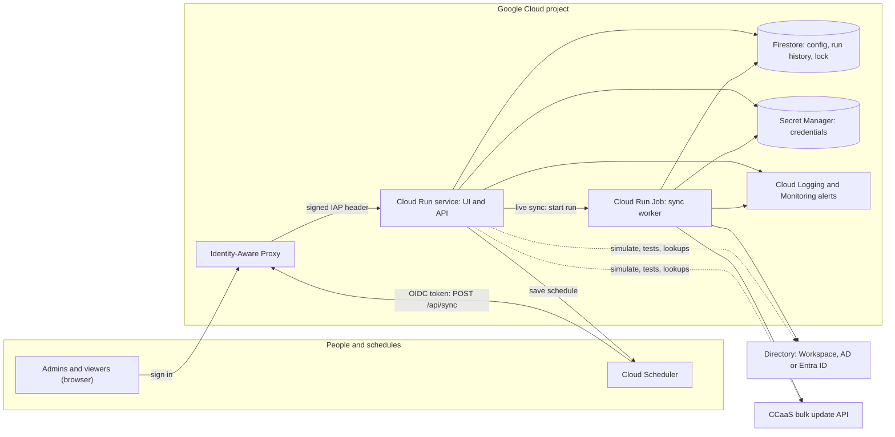
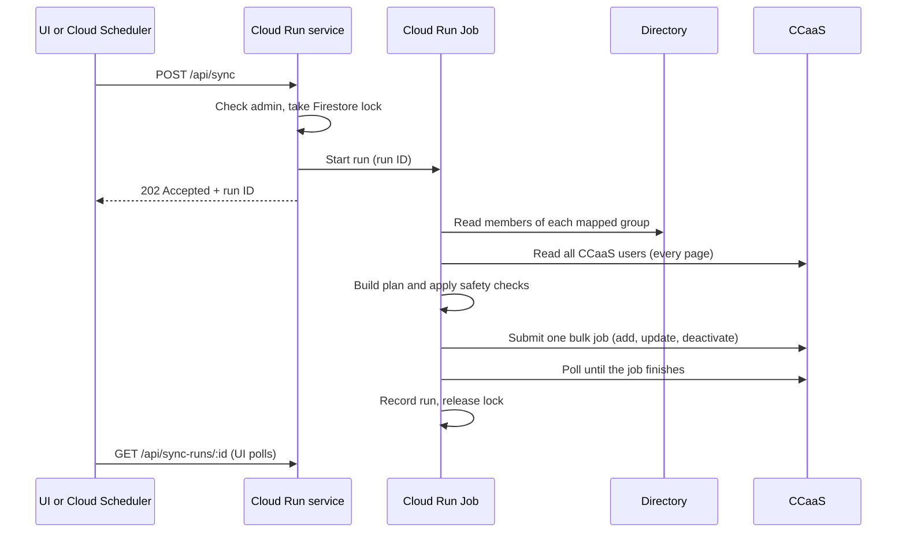

# CCaaS Bulk Sync: solution overview

CCaaS Bulk Sync keeps the users in Google Cloud Contact Center as a Service (CCaaS) in step with groups in a user directory: **Google Workspace**, **Microsoft Active Directory** or **Microsoft Entra ID**. Administrators map directory groups to CCaaS roles and teams. The service then adds, updates and deactivates CCaaS users to match, on a schedule or on demand.

For deployment steps, see the [README](README.md).

## Architecture

| Component | Role |
|---|---|
| **Identity-Aware Proxy (IAP)** | Signs users in and lets only allowed people (and the scheduler's service account) reach the app. Recommended: IAP directly on Cloud Run. A load balancer with a custom domain is also supported. |
| **Cloud Run service** | Serves the web UI and the `/api/*` API. Every API request must carry IAP's signed header. Only admins (`ADMIN_EMAILS`) can save the configuration, run live syncs or run connection tests; everyone else with IAP access is a viewer. Runs simulations. |
| **Cloud Run Job** (`<service>-sync`) | Runs live syncs. Moving them out of the request path means a sync that takes minutes isn't cut off by the roughly 30-second limit on browser requests through IAP. |
| **Cloud Scheduler** | Triggers scheduled syncs through IAP with an OIDC token. The service creates and updates the scheduler job when the schedule is saved (daily, hourly or cron, in a chosen time zone). |
| **Firestore** | Stores the configuration (with references to secrets, never the secrets themselves), the run history (newest 200 runs) and a lock so that only one live sync runs at a time. |
| **Secret Manager** | Stores the CCaaS API key and directory credentials. Saving a new credential adds a version and disables the old ones. Google Workspace can use keyless domain-wide delegation, so no key is stored at all. |
| **Cloud Logging and Monitoring** | One structured `sync_run` log entry per sync (counts and job IDs only, never user details). Optional alerts for failed or blocked syncs and for missing scheduled successes. |

## How a sync works

1. **Read the directory.** For every group mapping, read the group's members. With **Include members of nested groups**, members of nested groups at any depth count too.
2. **Read CCaaS.** Read every CCaaS user, across all pages.
3. **Build the plan.** Match users by email, without regard to case:
   - **Add:** in a mapped group but not in CCaaS. Created with the sync role plus every role and team from every mapping they match.
   - **Update:** managed by this tool and their roles, teams or name differ.
   - **Deactivate:** managed by this tool but no longer in any mapped group.
   - **Skip:** an existing CCaaS user not managed by this tool. Skipped and reported by default, or adopted if **Existing CCaaS Users** is set to **Adopt**.
4. **Check safety.** Abort if a mapped group is missing, or if the directory returns no users while CCaaS has managed users. Block scheduled syncs that would deactivate more than **Max Deactivations per Sync**; manual syncs can confirm **Run Anyway**.
5. **Apply.** Submit one CCaaS bulk job and follow it to completion. The run, its counts and the CCaaS job ID are recorded in the run history.

**Simulate Only** runs steps 1–4 in the service and returns the plan, including a per-user list of changes, without changing anything.

## Configuration

Everything is configured in the UI, under **Configuration**:

- **CCaaS Configuration:** the CCaaS host and API key.
- **Sync Schedule:** daily, hourly or cron, a time zone, the initial CCaaS job poll delay, the deactivation limit, how to treat existing CCaaS users, and whether to sync names.
- **Directory Configuration:** the **User Sync Custom Role** that marks users as managed by this tool, and the directory: Google Workspace (keyless delegation or a key), Active Directory (LDAP) or Entra ID (app registration), with a connection test.
- **Group Mappings:** each directory group maps to one or more CCaaS roles and teams, with an optional nested-groups setting. Roles and teams accumulate across mappings.

The other sections are **Jobs** (recent CCaaS bulk jobs), **Runs** (recent sync runs) and **Help**.

## Deployment and automation

- **Terraform** (`terraform/`) is the recommended way to deploy. It creates the APIs, Firestore, Artifact Registry, secrets, a least-privilege service account, the Cloud Run service and job, IAP, and optional alerts.
- **Cloud Build** (`cloudbuild.yaml`) builds the container image and deploys the service and the job. Use it for manual deployments and upgrades.
- **GitHub Actions** run the unit tests, a dependency audit, a container build and startup smoke test, Terraform validation and CodeQL on every pull request.
